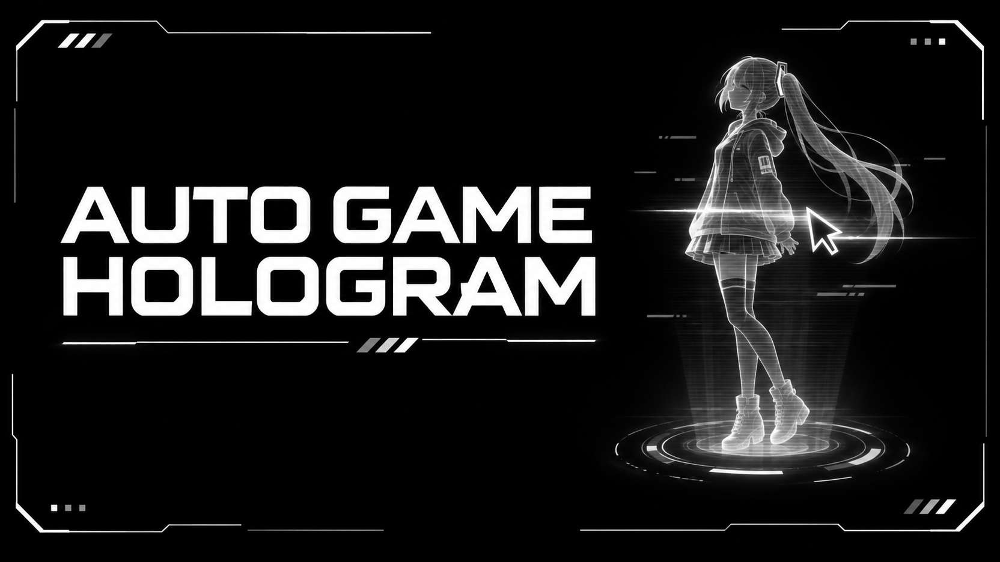

# Auto Game Hologram

Auto Game Hologram is a Windows code mod for [Capri Desktop](https://github.com/lachydotmcg/capri-desktop). It turns on Capri's click-through Hologram mode when a recognized game is in the foreground. When you leave the game, it restores the previous state if the mod made the change automatically.

To tell when a game is in front, it reads the title and app name of the window in front.

## Installation

1. Download [auto-game-hologram.capri-code](auto-game-hologram.capri-code).
2. Select and approve the code mod when prompted.

## Controls

- Press **Ctrl + Alt + F8** to toggle Hologram mode manually, including in games Capri does not detect.
- To change the shortcut, open **Mainframe → Settings → Keybinds** and select **Hologram hotkey** under **Gaming Mode**.
- Press your new key combination in the dialog. Capri saves it for future sessions.

## Compatibility

Version **1.2.1** was tested in-game on Windows with Capri 0.8.5.1. The mod uses internal Capri interfaces for game detection, Hologram mode and the Keybinds entry. Future Capri updates may require a mod update.

## Credits

- Made by: Dominik20074
- AI assisted with the code and banner.
