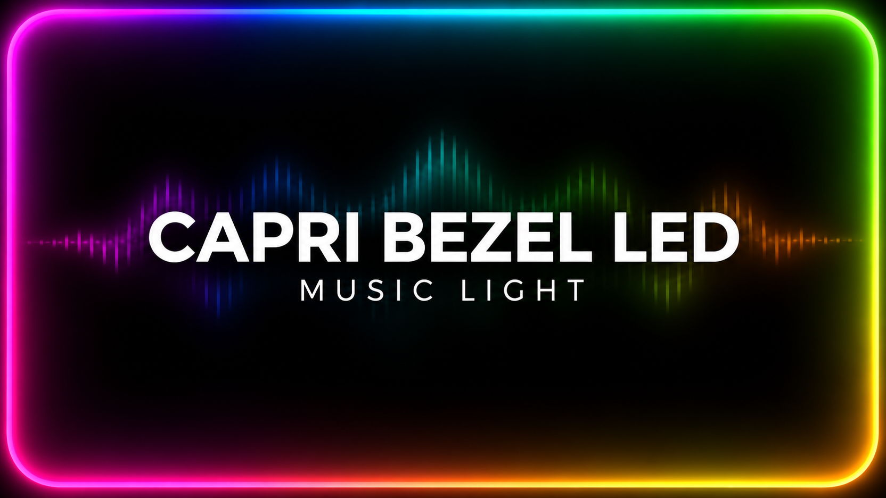

# Capri Bezel LED

Capri Bezel LED adds a music-reactive rainbow glow around the edges of your primary display. Colors travel around the screen and blend through the corners. The light fades into transparency toward the center, and mouse clicks pass through the overlay.

When Capri detects the beat, the glow pulses in time with it. While music is playing without a detected beat, the glow pulses gently. It fades out when playback stops.

## Installation

1. Download [capri-bezel-led.capri-code](capri-bezel-led.capri-code).
2. In Capri, open **Mainframe → CAPRI → Mods → Import mod** and select the file.
3. Approve the code mod when prompted.
4. Open **Mainframe → Settings → Capri** and use **Music Light**, directly below **Hologram**, to turn the effect on or off. The mod remembers your choice.

## Compatibility

Version **0.5.2** is a Windows code mod for Capri Desktop. It uses Capri's internal music detection and Mainframe controls. Future Capri updates may require a mod update.

## Credits

- Made by: Dominik20074
- AI assisted with the code and preview artwork.
