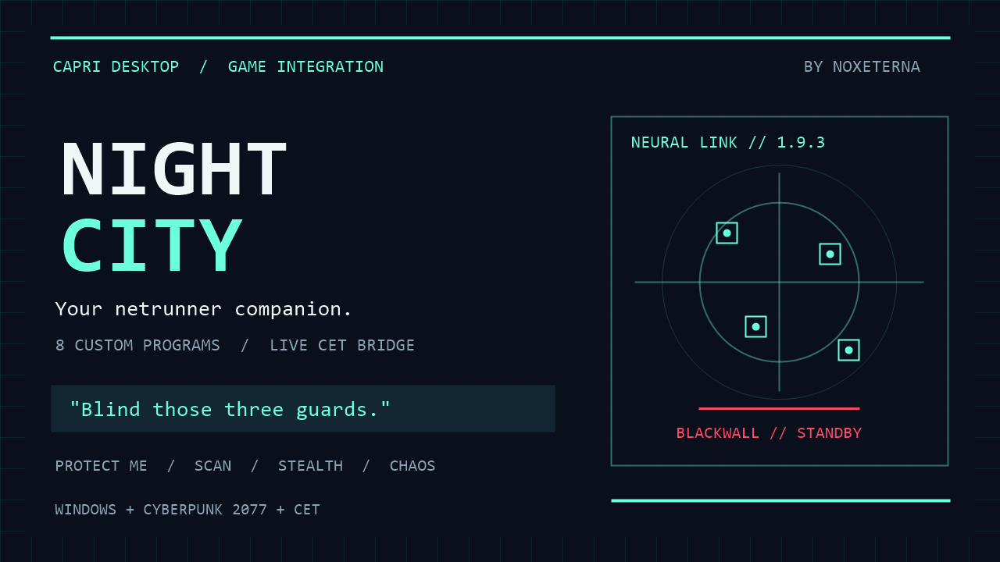

# Capri Night City

Connect Capri to Cyberpunk 2077 for nearby/group hacks, native scanner tags, vehicles and devices, eight custom netrunner programs, Protect Me, stealth and optional chaos.

- Made by: NoxEterna
- Version: 1.9.4
- Platform: Windows
- Requires: Capri Desktop, Cyberpunk 2077 and a separately installed Cyber Engine Tweaks (CET) bridge

## Install

Install and approve **Capri Night City** through Capri's Mods window. This directory entry installs only the `.capri-code` client.

The game connection also requires the [separate CET bridge download](https://github.com/SzentiX/capri-night-city/releases/tag/v1.9.4). Its Lua, optional scripts and full source live in [their own repository](https://github.com/SzentiX/capri-night-city). **That external download is separate from this submission and has not been checked by the Capri mod directory reviewers.** Follow its [manual bridge installation guide](https://github.com/SzentiX/capri-night-city/blob/main/BRIDGE-INSTALL.md).

After installing the bridge, say or type `night city connect` and select its **CapriNightCityBridge** folder containing `init.lua`. Start Cyberpunk, load a save, close the menus and check `night city status`.

## Commands

| Say or type | Result |
| --- | --- |
| `night city hacks` | List the eight custom programs. |
| `flatline him` | Request a kill on a nearby eligible NPC. |
| `blind the guy in front of me` | Use the aimed NPC. |
| `use Ghost Veil on those three guards` | Group memory wipe and blindness, up to five targets. |
| `scan` / `stop scanning` | Start native tagging / clear this mod's tags. |
| `protect me` / `protection off` | Toggle defensive control hacks. |
| `stealth mode on` / `go loud` | Enable quiet control / leave stealth. |
| `chaos mode on` / `chaos mode off` | Toggle optional nearby-target chaos. |
| `netrunner defense on` / `counterhack off` | Toggle incoming-hacker retaliation. |
| `emergency rescue on` / `emergency off` | Arm / disarm rescue below 50 raw HP, with a 120-second cooldown. |
| `stop the car` / `blow up the car` | Request a supported vehicle action. |
| `hack the camera` / `hack the access point` | Request a native device action / network breach. |
| `stand down` | Disable autonomous modes and cancel tracked pending effects. |
| `night city status` / `night city dashboard` | Diagnose the link and modes. |

General phrases including **stop it, open it, scan, calm down, go quiet, protect me and do your thing** are handled only with a fresh heartbeat, loaded save and closed menus. Without that live link, they pass through to Capri, so `stop it` can still cancel her ordinary jobs. Explicit `night city` commands remain available offline for setup and diagnostics; you can also prefix game commands, such as `night city scan`.

Use one action per command. Natural wording uses a bounded local grammar. See the external [command reference](https://github.com/SzentiX/capri-night-city/blob/main/COMMANDS.md) and [program guide](https://github.com/SzentiX/capri-night-city/blob/main/HACKS.md) for aliases, targeting and cooldowns.

## Privacy and limits

The bridge exchanges bounded local text files. Contextual report wording uses your configured Capri brain/provider, so a cloud provider receives the selected game facts. `night city quiet` mutes ambient game reactions; `night city reactions` enables them again. No key or separate mod telemetry service is bundled.

Default range is 35 m. Protected targets, children, bosses, V and V's occupied car are skipped. Protect Me targets hostiles; scanning neutral NPCs does not authorize automatic attacks. Native game targeting, device actions and HUD/cyberware restrictions still apply. A request acknowledgement is not proof of a kill, explosion or rendered outline. Completed game consequences persist.

Typing and Capri's normal local-brain voice dispatch support commands; the separate ElevenLabs server-agent route may bypass code mods. Internal Capri reporting interfaces may change in future versions.

The client compiled against Capri 0.8.6.1. The external test suite passed 222 game mocks and 289 client/protocol checks, including offline command-ownership regressions. Live gameplay, microphone/HUD behavior and profiling remain unverified. Disable/remove the client in Capri; follow the separate bridge guide to remove the game-side files.

Credit: [Capri Desktop by lachydotmcg and contributors](https://github.com/lachydotmcg/capri-desktop). Unofficial fan integration; no game assets included.
