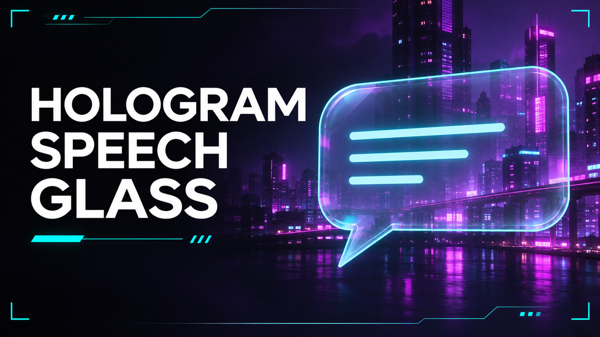

# Hologram Speech Glass

A Windows code mod for [Capri Desktop](https://github.com/lachydotmcg/capri-desktop) that makes Capri's speech bubble translucent in Hologram mode.

The mod shows a click-through copy of the speech bubble at 63% opacity while Hologram mode is active. The standard bubble returns when you exit Hologram mode or turn Speech Glass off.

## Installation

1. Download [hologram-speech-glass.capri-code](hologram-speech-glass.capri-code).
2. Open **Mainframe → CAPRI → Mods**, select the mod, and approve it.
3. Open **Mainframe → Settings → Capri** and use the **Speech Glass** switch below **Hologram**. The mod remembers your choice.

## Compatibility

Version 0.1.4 uses internal Capri interfaces for speech rendering and settings. Future Capri updates may require a mod update. Speech Glass can run alongside Capri Bezel LED v0.5.2.

## Credits

- Made by: Dominik20074
- AI assisted with the code and preview artwork.
